<div align="center">

# Loki

**Deterministic write-time code quality and anti-slop enforcement for AI coding agents.**

Loki sits between your coding agent and disk. Before an edit writes, it runs real
analyzers, structural complexity and duplication gates, a local code-hygiene
model, and security rules over the proposed file. Bad writes are refused with
the exact diagnostic before the file changes, without calling an LLM.


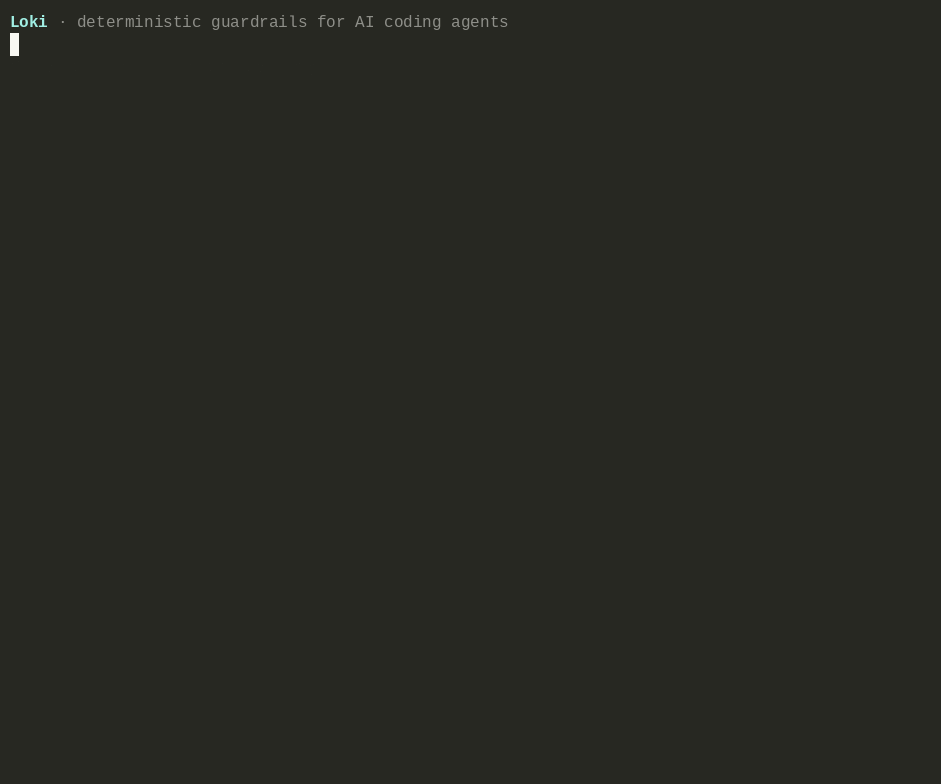

<sub>Real hook output from <a href="https://github.com/alfredosdpiii/loki/blob/main/docs/demo/demo.sh">docs/demo/demo.sh</a>. Only the typing is simulated.</sub>

</div>

## Why Loki

- **It stops code rot and bugs before they land.** Structural slop gates
  (`slop.block: true` by default), Ruff, Oxlint with `landmines`, a TypeScript
  type check, `codehygiene`, `nits`, and security rules run on the proposed file
  before the write. Complexity hotspots, clones, swallowed errors, XSS, leaked
  keys, and broken callers are refused before reaching disk.
- **It closes the shell-write loophole.** Agents with shell access often route
  around file-edit hooks by writing source files through redirects like
  `cat <<EOF > app.py`. Loki blocks shell file writes across all supported
  harnesses by default.
- **It only complains about what the edit changed.** Findings are compared
  against the committed file by rule and source line. Existing debt and shifted
  lines pass, so agents aren't blocked by code they didn't touch.
- **It uses real analyzers.** mypy, `tsc`, Oxlint, golangci-lint, Clippy, Credo,
  and Sobelow run on every write, all net-new. Twenty-six tool-free rules cover
  what linters miss: SSRF, open redirects, request-trusted authorization, shell
  `-c` injection, ReDoS, zip slip, prototype pollution, GitHub Actions
  injection, and more.
- **It stays fast on every edit.** Hook stages run in parallel with capped time
  budgets, and a per-repository daemon keeps the TypeScript checker, `dmypy`,
  `codehygiene`, `nits`, and build caches warm. A TypeScript check takes about
  40 ms warm instead of 500 ms.
- **It enforces code hygiene and structural simplicity.** Every write runs the
  compiled-in [codehygiene](https://github.com/brianbell-x/codehygiene) model,
  [nits](https://github.com/jkomyno/nits) tree-sitter rules, and `loki slop`
  complexity, clone, and import-cycle checks. First-time hygiene findings and
  new complexity hotspots block the write instead of piling up across turns.

## Benchmarks

### SlopCodeBench (`gpt-6.1-sol` medium)

Evaluated on [SlopCodeBench](https://github.com/SprocketLab/slop-code-bench)
across 36 Python problems and 196 checkpoints with `gpt-6.1-sol` at `medium`
reasoning effort on `codex 0.159.2`. Model, effort, agent binary, and the
unmodified `just-solve` prompt matched the published leaderboard run, with zero
benchmark-specific rules or thresholds. The only addition was Loki strict write
hooks with `slop.block: true`, hygiene checks, and `shell-writes`.

| Metric | Direction | Published baseline | Codex + Loki Strict | Change |
| --- | --- | ---: | ---: | ---: |
| Strict Solve | Higher is better | 14.80% | **15.82%** | **+1.02 pp** |
| Iso Solve | Higher is better | 29.08% | **31.63%** | **+2.55 pp** |
| Cost / checkpoint | Lower is better | $0.91 | **$0.38** | **-58%** |
| Erosion | Lower is better | 0.7040 | **0.0969** | **-86.2%, 7.3x lower** |
| Verbosity | Lower is better | 0.2180 | **0.1113** | **-48.9%** |

Mean functions over CC 10 stayed at 0.51 per checkpoint with a median of 0.
Total spend across all 196 checkpoints was $75.11, with a median of $0.32 per
checkpoint. Checkpoint pass rates reached 85.1% on core tests at 134/196, 86.2%
on regressions, and 90.8% on error handling.

Against the published `just-solve` leaderboard:

| Model | Harness | Strict Solve | Iso Solve | $/CKPT | Erosion | Verbosity |
| --- | --- | ---: | ---: | ---: | ---: | ---: |
| #1 GPT 5.6 SOL (XHigh) | Codex 0.145.0 | 14.29% | 32.14% | $3.84 | 0.658 | 0.376 |
| #2 GPT 6 Astra (XHigh) | Codex 0.153.3 | 16.33% | 31.63% | $3.87 | 0.559 | 0.158 |
| **GPT 6.1 SOL (Medium) + Loki** | **Codex 0.159.2** | **15.82%** | **31.63%** | **$0.38** | **0.097** | **0.111** |
| #3 Opus 5.5 (Medium) | Claude Code 2.1.280 | 14.29% | 29.59% | $0.99 | 0.700 | 0.347 |
| #4 GPT 6 Astra (Medium) | Codex 0.159.2 | 14.80% | 29.08% | $1.33 | 0.701 | 0.229 |
| #5 GPT 6.1 SOL (Medium) | Codex 0.159.2 | 14.80% | 29.08% | $0.91 | 0.704 | 0.218 |

Starting from the 5th-place model, Loki tied #2 GPT 6 Astra (XHigh) on Iso Solve
at 31.63%, sat one checkpoint behind on Strict Solve at 15.82% vs 16.33%, cost
10x less at $0.38 vs $3.87 per checkpoint, and beat every published model on
Erosion at 0.097 vs 0.559 and Verbosity at 0.111 vs 0.158.

All 36 problems in this run are Python on Codex 0.159.2. Full scores and raw
`result.json` are posted on `SprocketLab/slop-code-bench#55`.

#### Before and after Loki on the same problem

On `dag_execution` checkpoint 3 with `gpt-6.1-sol` at `medium` effort on Codex
0.159.2, an unconstrained run produced 17 functions over CC 10 with erosion
0.681 and a max CC of 53. With Loki Strict, erosion dropped to 0.029, zero
functions exceeded CC 10, and the 92-line `evaluate()` monolith became a
16-line CC 2 dispatch table with small helpers:

| Metric on `dag_execution` checkpoint 3 | Without Loki | With Loki Strict |
| --- | ---: | ---: |
| Checkpoint erosion | 0.681 | **0.029** |
| Functions with CC > 10 | 17 / 84 | **0 / 148** |
| Max function CC | 53 | **10** |
| Longest top function | 92 lines | **24 lines** |

Without Loki (`pipeline.py:754`, CC 53, 92 lines, excerpt):

```python
def evaluate(self, node: Node, gate: bool = False):
    kind, args = node.kind, node.args
    if kind == "literal":
        return self.interpolate(args[0]) if isinstance(args[0], str) else args[0]
    if kind == "ref":
        return self.reference(args[0])
    if kind == "var":
        name = args[0]
        if name in self.variables:
            return self.variables[name]
        if name in ("stdout", "stderr", "exit_code", "exitcode", "code"):
            return Stream(getattr(self, {"exitcode": "exit_code", "code": "exit_code"}.get(name, name)))
        if name == "output":
            return str(self.cwd)
        if name == "params":
            return self.params
        raise PipeError(f"undefined variable {name}")
    if kind == "attribute":
        value = self.evaluate(args[0], gate)
        if not isinstance(value, dict) or args[1] not in value:
            raise PipeError(f"undefined attribute {args[1]}")
        return value[args[1]]
    if kind == "index":
        value, index = (self.evaluate(x, gate) for x in args)
        if type(index) is not int or not isinstance(value, (list, str)):
            raise PipeError("array index must be an int")
        # ... continues 60+ more lines for unary, binary, call
```

With Loki Strict (`pipeline_runner.py:969`, CC 2, 16 lines + small helpers):

```python
def evaluate(self, expr):
    kind = expr[0]
    handlers = {
        "literal": self.literal,
        "ref": self.ref_value,
        "var": self.variable,
        "member": self.member,
        "list": self.list_value,
        "index": self.index,
        "unary": self.unary,
        "binary": self.binary,
        "call": self.call,
    }
    if kind not in handlers:
        raise InvalidPipe(f"Unknown expression {kind}")
    return handlers[kind](expr)

def variable(self, expr):
    name = expr[1]
    if name in self.variables:
        return self.variables[name]
    if name == "params":
        return self.params
    if name in {"stdout", "stderr", "exit_code", "exitcode", "code"}:
        return getattr(self, "exit_code" if name in {"exitcode", "code"} else name)
    if name in {"output", "workspace"}:
        return self.reference(name)
    raise InvalidPipe(f"Undefined variable {name}")
```

### Head-to-head vs Interlinked CLI

Head to head with [Interlinked CLI](https://github.com/QuentinCody/interlinked-cli)
(`82307ea`), both installed as Claude Code hooks. Each ran in a fresh sandboxed
repository per case and repetition. A defect counts only if the right diagnostic
appears on every repetition.

| Suite | Loki caught | Interlinked caught | Loki prevented before write | Loki false blocks | Interlinked false blocks |
| --- | ---: | ---: | ---: | ---: | ---: |
| **Blind holdout** (60 unseen cases, before any tuning) | **33** | 12 | **19** | 3 | 2 |
| Development corpus | **46/47** | 20/47 | **36** | **0** | 1 |
| Missing project-local JS tools | **17/17** | 13/17 | **17** | **0** | 1 |
| Holdout 1 (tuned) | **41/48** | 11/48 | **26** | **0** | 1 |
| Holdout 2 (tuned) | **42/60** | 12/60 | **29** | **0** | 2 |

Median hook latency is on par (402 ms vs 389 ms) with a much shorter tail
(p95 1.6 s vs 6.4 s). Without project-local JS tools, Loki takes 334 ms against
Interlinked's 10.8 s. Every holdout defect Interlinked catches, Loki catches too.

These are synthetic cases, not production sessions. The blind holdout was written
by an agent that could not see either product. Read the
[full results](https://github.com/alfredosdpiii/loki/blob/main/artifacts/comprehensive-summary-2026-09-26.md) and the
[benchmark protocol](https://github.com/alfredosdpiii/loki/blob/main/benchmarks/README.md).

## Quick start

Loki is a standalone Rust CLI binary with templates, shims, and vendored plugins
compiled in.

**1. Install the binary** (once per machine):

```bash
cargo install loki-guardrails
# or from a checkout: cargo install --path .
```

**2. Set up a repository:**

```bash
cd your-repo
loki init --dir .
```

This adds your policy and vendored plugins in `.loki/` (`loki.json`,
`oxlint/anti-slop`, `oxlint/landmines`, `vendor/codehygiene`), hooks for every
supported agent (`.agents/`, `.claude/`, `.codex/`, `.factory/`, `.pi/`, `.omp/`), starter
Ruff, Oxlint and golangci-lint configuration, and a `.github/workflows/loki.yml`
CI check. Existing configuration files are left alone.

**3. Finish the setup:**

- For JavaScript or TypeScript, install Oxlint with the command `init` prints,
  e.g. `npm i -D oxlint @oxlint/plugins`.
- Antigravity (`agy`), Claude Code and OMP pick the hooks up automatically. In Codex, run `/hooks` and
  approve them; Pi asks you to trust the project.
- **Commit the new files yourself.** Loki reads its policy from the committed
  version, never the working tree, so an agent can't loosen the rules mid-session.
  Until you commit, `scan` reports the setup as changes awaiting review.

```bash
git add .loki .agents/hooks.json .claude .codex .factory .pi .omp .ruff.toml .oxlintrc.json \
  .golangci.yml .github/workflows/loki.yml
git commit -m "Add Loki"
```

**4. Use your agent as usual.** On every edit:

- **Blocked before the write:** dangerous edits (XSS, leaked keys, injection,
  edits to Loki's own files), TypeScript type errors, `landmines` Oxlint
  findings (and missing `oxlint` on TypeScript writes), new structural slop
  hotspots, clones, and import cycles (`slop.block: true`), first-time
  `codehygiene` and `nits` findings on added lines, and shell commands that try
  to write source files via redirects.
- **Reported after the write:** net-new findings from mypy, `tsc`,
  golangci-lint, Clippy, Credo, and Sobelow, along with repeated hygiene notes.
  Only what the edit introduced counts; existing debt stays quiet.

The first edit starts a background daemon that keeps analyzers warm.

**5. Check the whole repository whenever you like:**

```bash
loki scan                          # everything changed since the last commit
loki scan --base origin/main       # everything on your branch
loki slop                          # sloppiness score and complexity hotspots
loki slop --base main              # how this branch changed the score
loki hygiene --base main           # codehygiene and nits notes on added lines
```

The installed CI workflow runs `scan --strict` on every push and pull request.
Strict mode fails when an analyzer is missing instead of skipping it.

**Upgrading:**

```bash
cargo install loki-guardrails --force
loki init --dir . --force          # updates vendored plugins and hooks in .loki/; review and commit
```

The [install guide](https://github.com/alfredosdpiii/loki/blob/main/docs/reference.md#install)
covers each host in detail.

## How it works

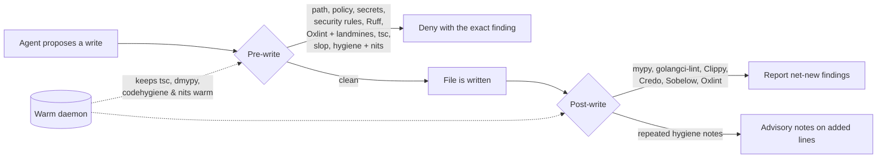

1. **Before the write,** Loki reconstructs the file the agent is about to
   produce. It runs protected-path checks, tool-free security rules, Ruff,
   Oxlint with `landmines`, a TypeScript type check, structural slop gates, and
   first-hit `codehygiene` and `nits` checks in parallel with capped budgets. A
   denial carries the exact diagnostic. Shell commands that write source files
   through redirects are refused by `shell-writes`.
2. **After the write,** the language's analyzers run on what landed. New
   findings go back to the agent, while existing debt stays quiet.
3. **In CI,** `scan` repeats the checks against a base revision, including test
   integrity, dependency policy, and lockfile consistency.

Loki blocks its own policy files, hook registration and CI workflow from agent
edits, so an agent can't switch it off.

## What it catches

| Language | On every write | Tool-free rules |
| --- | --- | --- |
| **Python** | Net-new Ruff and mypy (annotated code), import and AST checks | request-trusted authorization, SSRF, path traversal, shell `-c`, timing-unsafe compares, ReDoS, tautological tests, SQL injection, `eval` and unsafe deserialization of request data, unsafe `yaml.load`, open redirects, disabled TLS |
| **TypeScript / JS** | Oxlint (with vendored `anti-slop` + [landmines](https://github.com/interfere-inc/landmines) plugins), project type check (pre-write), floating promises, numeric `.sort()` | XSS sinks, open redirects, `eval`, command and SQL injection, SSRF, prototype pollution, `postMessage` origin, timer leaks, ReDoS, disabled TLS |
| **Go** | gofmt, go vet, golangci-lint with gosec on changed lines | zip slip, SQL built with `Sprintf`/`+`, shell `-c`, `InsecureSkipVerify` |
| **Rust** | rustfmt, net-new Clippy and compiler errors | placeholders, unchecked `get_unchecked`, unflushed `BufWriter`, shell `-c`, SQL built with `format!`, `danger_accept_invalid_*` |
| **Elixir / Phoenix** | mix format, net-new Credo and Sobelow | request-trusted authorization, SSRF, open redirects, structural `DateTime` sorts, unhandled `File` results, leaked handles |
| **Any file** | protected paths, root confinement | hardcoded credentials, merge-conflict markers, GitHub Actions script injection |

Missing analyzers are reported as `NOT CHECKED`, never as clean, and
`LOKI_STRICT=1` turns them into failures. The [reference](https://github.com/alfredosdpiii/loki/blob/main/docs/reference.md)
documents every rule, threshold and limitation.

## Scenarios where Loki fires

Every GIF below is real output from `loki` (`docs/demo/record-scenarios.sh`).

### 1. Python security: SQL injection, SSRF & unsafe `yaml.load`

<div align="center">

</div>

### 2. Rust security: `format!` SQL injection & disabled TLS

<div align="center">
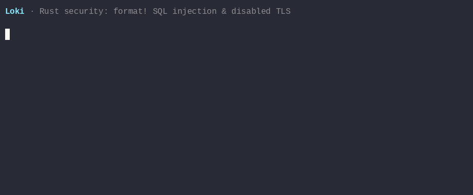
</div>

### 3. Rust anti-slop & safety: `todo!()`, unflushed `BufWriter`, unchecked index & missing `SAFETY`

<div align="center">
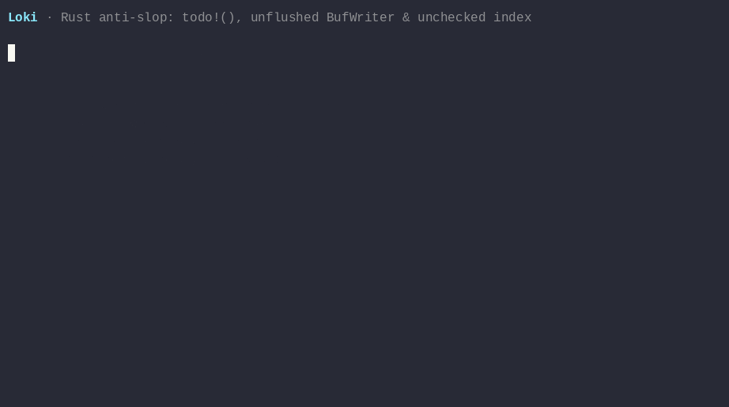
</div>

### 4. Python anti-slop: tautological tests & silent `except: pass`

<div align="center">
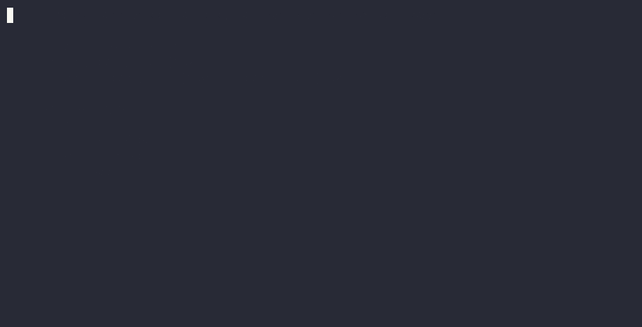
</div>

### 5. Elixir safety: structural `DateTime` sort

<div align="center">
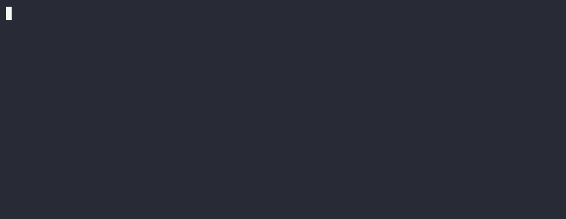
</div>

### 6. GitHub Actions: untrusted script injection

<div align="center">
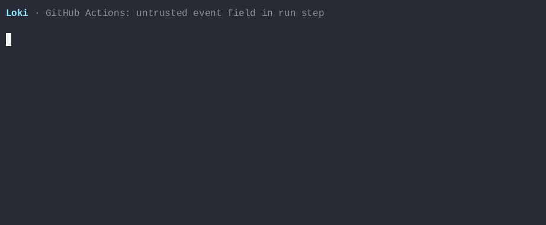
</div>

### 7. Any file: unresolved merge-conflict markers

<div align="center">
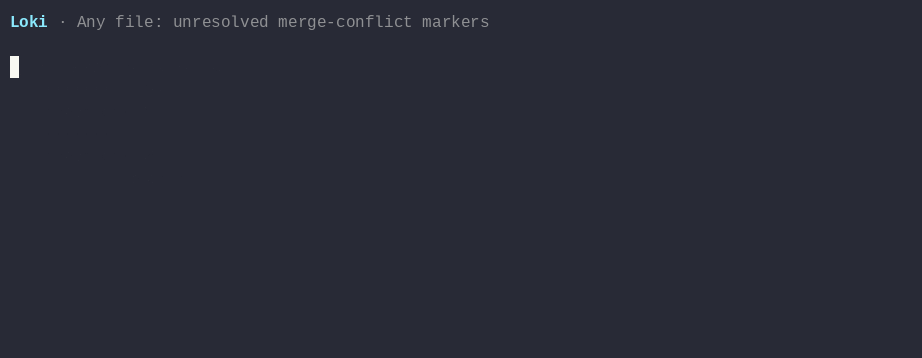
</div>

### 8. Shell guard: destructive Git command blocked

<div align="center">

</div>

### 9. Shell guard: shell redirect write-bypass blocked

<div align="center">
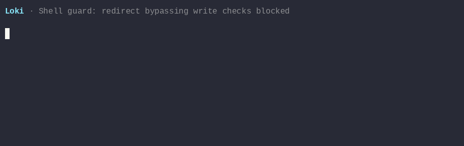
</div>

### 10. Policy protection: tampering with `.loki/loki.json` blocked

<div align="center">
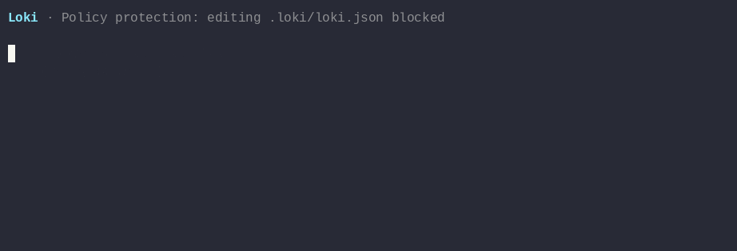
</div>

## Oxlint + landmines + anti-slop

For TypeScript and JavaScript repositories, `loki init` installs both
[anti-slop](https://github.com/dmmulroy/anti-slop) and
[interfere-inc/landmines](https://github.com/interfere-inc/landmines) directly
into `.loki/oxlint/` and wires them into `.oxlintrc.json`. Both plugins are
vendored with zero extra npm dependencies beyond `oxlint` and `@oxlint/plugins`.
When installed, `landmines` plugins run in the pre-write Oxlint preview, and a
missing `oxlint` refuses TypeScript writes instead of passing them unchecked.

The four `landmines` plugins block common AI-agent shortcuts at `"error"` level:

- **`landmines-testing`:** `no-test-doubles` (mocks, stubbed globals, fake
  responses), `no-fixed-sleep`, `no-flake-masking` (retries and raised
  timeouts), `no-unsignaled-poll`, `strict-msw`.
- **`landmines-style`:** `no-comments` (keeps directives, TSDoc on public API,
  and `// WARNING:` / `// SAFETY:` comments).
- **`landmines-structure`:** `colocated-tests`, `test-file-names`,
  `package-exports`.
- **`landmines-types`:** `no-explicit-return-types`.

<div align="center">

<br>
<sub>Real hook output from <a href="https://github.com/alfredosdpiii/loki/blob/main/docs/demo/landmines.sh">docs/demo/landmines.sh</a>. Only the typing is simulated.</sub>
</div>

## Code hygiene & nits

On every write (`"hygiene": "on"` by default), Loki runs two local readability
and error-handling checks over the lines the edit adds. New findings refuse the
write the first time they appear, tracked in `.git/loki-hygiene-refused` without
line numbers; if the agent repeats the same finding, it becomes advisory.

- **[codehygiene](https://github.com/brianbell-x/codehygiene)** (1.58-bit
  ternary model compiled in and executed in-process in pure Rust, with no Python
  or NumPy required). Default `on` catches `swallowed_error` (with Python
  `except` structural filtering so dict fallbacks like `d.get(k) or []` and
  handlers that record errors aren't flagged), `noisy_comment`,
  `duplicate_block` (move-aware for 3+ line refactors), and `special_casing`.
  Scoring is windowed around changed hunks and parallelized across cores.
- **[nits](https://github.com/jkomyno/nits)** (tree-sitter rules for Python,
  TypeScript, JavaScript and Rust, pinned to a commit and run only from local
  Python or `uv`'s offline cache; never downloaded at hook time). Default `on`
  reports rules with measured precision >= 0.80, such as
  `error-to-empty-success`.

When both flag the same kind on the same line, Loki keeps only the `nits` note.
Both workers stay warm in the per-repository daemon so repeated writes avoid
cold-start overhead.

<div align="center">
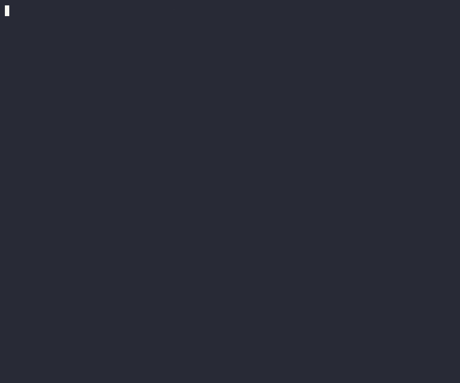
<br>
<sub>Real hook and CLI output from <a href="https://github.com/alfredosdpiii/loki/blob/main/docs/demo/hygiene.sh">docs/demo/hygiene.sh</a>. Only the typing is simulated.</sub>
</div>

Run on demand over modified and untracked files at any time:

```bash
loki hygiene                       # default high-precision checks against HEAD
loki hygiene --base main           # everything added on this branch
loki hygiene --level all           # include layout, naming and lower-precision nits
loki hygiene --json                # machine-readable findings and not_checked notes
```

## Structural sloppiness

`loki slop` puts a single number on how hard code is to change. It combines
the erosion metric from
[Measuring code sloppiness](https://earendil.com/posts/measuring-code-sloppiness/)
with [trellis](https://github.com/jayminwest/trellis)'s scoring:

```text
$ loki slop
Sloppiness index: 26/100 (lower is better; trellis 0.2.0-provisional weights)
  complexity-erosion  26.2  eroded share 0.94, 1 of 4 functions with CC > 10
  duplication          0.0  density 0.00, 0 clone groups
  import-cycle         0.0  density 0.00, 0 cycles
hotspot src/discounts.ts:1 discount CC 17, 15 SLOC, mass 65.8
```

Complexity is exact for Python, TypeScript/JavaScript, Go and Elixir using each
language's own parser. It is approximated structurally for Rust, Java, Kotlin, C#,
C/C++, Swift, Scala, PHP and Ruby. Clones are detected on normalized tokens, so
renamed copies count. Test and fixture directories (`fixtures`, `__fixtures__`,
`testdata`) are excluded from production slop metrics automatically, and
`slop.exclude` adds repo-specific globs. `loki init` sets `slop.block: true` by
default so new hotspots, clones, and import cycles block writes right away.
`--base` compares against a revision without hitting a repo-size ceiling, and
`max_index` or `max_index_increase` can gate CI.

<div align="center">
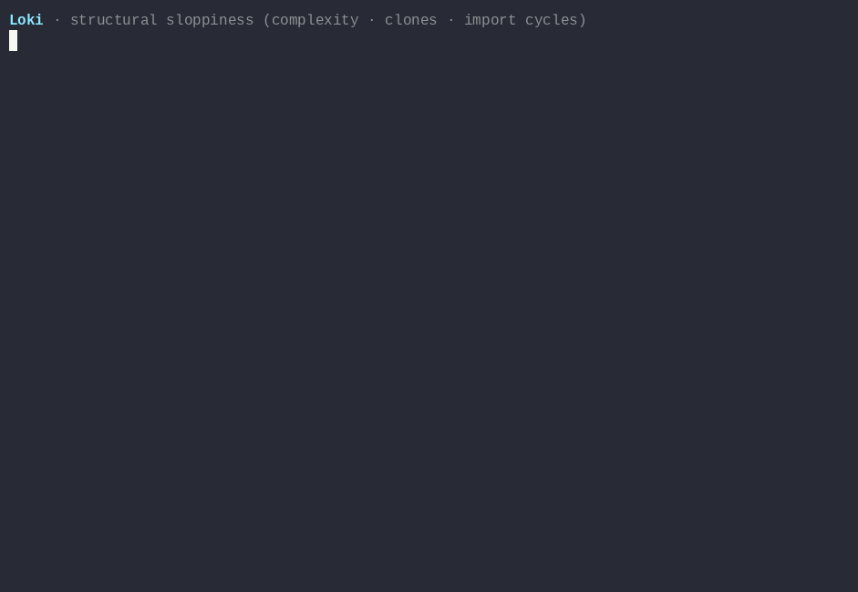
<br>
<sub>Real CLI output from <a href="https://github.com/alfredosdpiii/loki/blob/main/docs/demo/slop.sh">docs/demo/slop.sh</a>.</sub>
</div>

## Configuration

Policy lives in `.loki/loki.json` and is always read from the committed base, so
an agent can't loosen it mid-session:

```json
{
  "rule_packs": ["core", "python", "typescript", "phoenix", "shell"],
  "shell_commands": [
    {"command": "npm test", "cwd": ".", "inputs": ["package.json", "package-lock.json"]}
  ],
  "slop": {"block": true, "max_index": 40, "max_index_increase": 2, "exclude": ["generated/**"]},
  "elixir_security": {"sobelow": {"block": "high", "warn": "medium"}}
}
```

| Setting | Default | Effect |
| --- | --- | --- |
| `typescript_check` | on when `tsconfig.json` exists | `false` disables it; `true` makes setup problems block |
| `slop.block` | `true` from `loki init` (`false` if omitted) | Blocks writes that introduce new complexity hotspots, clones, or import cycles |
| `slop.exclude` | `[]` | Glob patterns excluded from `loki slop` and write-time slop checks (in addition to tests and `fixtures/`/`testdata/`) |
| `hygiene` | `"on"` | `"off"` disables it; `"all"` adds layout, naming and lower-precision nits rules |
| `LOKI_HYGIENE` | unset | `off`, `on` or `all`; overrides `hygiene` |
| `shell_commands` | none | Exact, reviewed shell commands admitted when `--shell-guard` is enabled (blocks inline-interpreter writes too; `shell-writes` blocks shell file redirects by default) |
| `LOKI_STRICT=1` | off | Missing analyzers fail instead of reporting `NOT CHECKED` |
| `LOKI_PYTHON=<path>` | active venv or conda env, then `.venv` | The project's interpreter, asked whether a new import exists (`--python` on `hook`, `protect` and `scan`) |
| `LOKI_DAEMON=0` | on | Runs every hook in-process |

## Supported agents

| Agent | Integration |
| --- | --- |
| Antigravity (`agy`) | `.agents/hooks.json` hooks with Pre/PostInvocation diagnostic spool |
| Claude Code | `.claude/settings.json` hooks |
| Codex | `.codex/hooks.json` hooks |
| Factory Droid | `.factory/hooks.json` hooks |
| Pi | `.pi/extensions/loki.ts` |
| OMP | `.omp/extensions/loki.ts` |
| [Ultron](https://github.com/alfredosdpiii/ultron) | built in (`loki init --minimal` installs `.loki/` only) |

## Documentation

- [Reference](https://github.com/alfredosdpiii/loki/blob/main/docs/reference.md): every check, rule, threshold and limitation
- [Benchmark protocol](https://github.com/alfredosdpiii/loki/blob/main/benchmarks/README.md) and the
  [latest results](https://github.com/alfredosdpiii/loki/blob/main/artifacts/comprehensive-summary-2026-09-26.md)
- [Blind holdout cases](https://github.com/alfredosdpiii/loki/blob/main/benchmarks/holdout2_cases.json) and the
  [runner](https://github.com/alfredosdpiii/loki/blob/main/benchmarks/holdout.py)

## Development

```bash
cargo test
cargo clippy --all-targets -- -D warnings
cargo build --release
```

Regenerate the demos with:

```bash
asciinema rec --cols 96 --rows 34 --overwrite -c "bash docs/demo/demo.sh" docs/demo/demo.cast
agg docs/demo/demo.cast docs/demo/demo.gif

asciinema rec --cols 96 --rows 34 --overwrite -c "bash docs/demo/hygiene.sh" docs/demo/hygiene.cast
agg docs/demo/hygiene.cast docs/demo/hygiene.gif

asciinema rec --cols 96 --rows 34 --overwrite -c "bash docs/demo/landmines.sh" docs/demo/landmines.cast
agg docs/demo/landmines.cast docs/demo/landmines.gif

bash docs/demo/record-scenarios.sh
```
